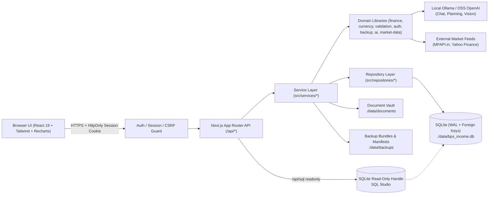

# BPS Wealth — System Architecture

> **Status**: Baseline + Production-Readiness Target Architecture  
> **Stack**: Next.js 15 (App Router, Turbopack), React 19, TypeScript, Tailwind CSS v4, SQLite (`better-sqlite3`), Drizzle ORM, Recharts, ExcelJS (`exceljs`), Zod, Ollama / OpenAI-compatible local or remote AI endpoints.

---

## 1. High-Level Architecture Diagram

---

## 2. Module Dependency Map

```mermaid
flowchart TD
  UI_Shell["AppShell + PinGate"] --> AuthAPI["/api/auth/pin"]
  UI_Dash["Dashboard (/)"] --> DashAPI["/api/dashboard"]
  UI_Dash --> PricesAPI["/api/prices/refresh"]
  UI_Dash --> BackupAPI["/api/backup"]
  UI_Inv["Investments (/investments)"] --> InvAPI["/api/investments"]
  UI_Inv --> CatAPI["/api/categories"]
  UI_Inv --> MatrixAPI["/api/investments/matrix"]
  UI_InvDet["Holding Detail (/investments/[id])"] --> TxnAPI["/api/investments/[id]/transactions"]
  UI_Inc["Income & Rentals (/income)"] --> IncAPI["/api/income"]
  UI_Inc --> RentAPI["/api/rentals"]
  UI_Quick["Quick-Log (/quick-log)"] --> QuickAPI["/api/quick-log"]
  UI_Loans["Loans & Insurance (/loans)"] --> LoansAPI["/api/loans"]
  UI_Loans --> InsAPI["/api/insurance"]
  UI_Loans --> DocsAPI["/api/documents"]
  UI_Loans --> AiExtAPI["/api/ai/extract"]
  UI_Imp["Import & Backup (/import)"] --> ImpAPI["/api/import"]
  UI_Imp --> BackupAPI
  UI_SQL["SQL Studio (/sql-studio)"] --> SqlAPI["/api/sql"]
  UI_Set["Settings (/settings)"] --> SetAPI["/api/settings"]
  UI_Set --> AuthAPI
  UI_AI["AiAssistantDrawer + AiInsightBanner"] --> AiAPI["/api/ai"]
  UI_AI --> AiExtAPI
```

---

## 3. Database Relationship Overview

```mermaid
erDiagram
  APP_SETTINGS {
    text key PK
    text value
    text updated_at
  }
  AUTH_SESSIONS {
    text id PK
    text token_hash
    text expires_at
    text created_at
    text last_seen_at
  }
  INVESTMENT_CATEGORIES {
    int id PK
    text slug UK
    text label
    text color
    int supports_sip
    int is_system
  }
  INVESTMENT_HOLDINGS {
    int id PK
    text name
    text asset_class
    text currency
    text scheme_code
    text ticker
    int invested_minor
    int current_value_minor
    real units
    real current_nav
    text status
  }
  INVESTMENT_TRANSACTIONS {
    int id PK
    int holding_id FK
    text date
    text type
    int amount_minor
    text currency
    real fx_rate
    real nav_or_price
    real units
  }
  INCOME_ENTRIES {
    int id PK
    text month
    text date
    text source
    text category
    int gross_minor
    int inhand_minor
    int tds_minor
    int rental_payment_id FK
  }
  RENTAL_PROPERTIES {
    int id PK
    text name
    int advance_paid_minor
    int advance_pending_minor
    int monthly_rent_minor
    text status
  }
  RENTAL_PAYMENTS {
    int id PK
    int property_id FK
    text billing_month
    int rent_minor
    int solar_minor
    int deductions_minor
    int total_minor
  }
  LOANS {
    int id PK
    text name
    int principal_sanctioned_minor
    int current_balance_minor
    real interest_rate
    int emi_minor
    text status
  }
  LOAN_TRANSACTIONS {
    int id PK
    int loan_id FK
    text txn_date
    text type
    int debit_minor
    int credit_minor
    int balance_after_minor
  }
  INSURANCE_POLICIES {
    int id PK
    text name
    text policy_type
    int premium_minor
    text premium_frequency
    text status
  }
  ASSET_REGISTER {
    int id PK
    text name
    text asset_type
    int current_value_minor
    int linked_loan_id FK
  }
  NET_WORTH_SNAPSHOTS {
    int id PK
    text date
    int total_assets_minor
    int total_liabilities_minor
    int liabilities_known
    int net_worth_minor
    text source
  }
  FINANCIAL_GOALS {
    int id PK
    text name
    text category
    int target_minor
    int current_minor
    text target_date
  }
  DOCUMENTS {
    int id PK
    text entity_type
    int entity_id
    text title
    text original_name
    text mime_type
    int size_bytes
    text file_path
    text sha256
  }
  IMPORT_HISTORY {
    int id PK
    text file_name
    text file_sha256
    text mode
    text status
    text summary_json
    text created_at
  }

  INVESTMENT_HOLDINGS ||--o{ INVESTMENT_TRANSACTIONS : "has"
  RENTAL_PROPERTIES ||--o{ RENTAL_PAYMENTS : "receives"
  LOANS ||--o{ LOAN_TRANSACTIONS : "tracks"
  LOANS ||--o{ ASSET_REGISTER : "finances"
```

---

## 4. Module Inventory & Technical Details

### 4.1 Dashboard
- **Purpose**: Executive summary of net worth, investment portfolio, asset allocation, income streams, liabilities, insurance coverage, goals, and emergency fund progress.
- **UI Components**: `src/app/page.tsx`, `src/components/AiInsightBanner.tsx`, `src/components/AiAssistantDrawer.tsx`.
- **API Endpoints**: `GET /api/dashboard`, `POST /api/prices/refresh`, `POST /api/backup`.
- **Database Tables**: `investment_holdings`, `investment_transactions`, `income_entries`, `rental_properties`, `rental_payments`, `loans`, `insurance_policies`, `net_worth_snapshots`, `financial_goals`, `investment_categories`, `documents`, `asset_register`, `app_settings`.
- **Business Logic**: Aggregates active holdings converted to INR, computes portfolio XIRR across authoritative transaction ledger cashflows (using transaction-level historical FX rates for inflows/outflows and current FX rate for terminal valuation), calculates separate income streams (`salary`, `rental`, `dividend`, `other`) without double-counting rental receipts, normalizes insurance premiums, and computes true Net Worth (`investment portfolio + non-portfolio financial assets + physical assets - liabilities`).
- **Dependencies**: `finance`, `currency`, `portfolio` service, `recharts`.
- **Data Flow**: `DashboardPage` -> `GET /api/dashboard` -> `PortfolioService` -> Repositories -> SQLite -> normalized JSON -> charts & KPI cards.
- **Error Handling**: Returns `401` when locked; standardized error JSON; UI displays loading skeleton and error/empty banners.

### 4.2 Net Worth & Asset Register
- **Purpose**: Tracks total personal net worth separately from investment portfolio value, plus historical net worth milestones.
- **UI Components**: `src/app/page.tsx` (Hero + Timeline), Net Worth / Asset Register section (on Dashboard / Settings or dedicated asset register).
- **API Endpoints**: `GET /api/dashboard`, `GET/POST/DELETE /api/assets`, `POST /api/import`.
- **Database Tables**: `asset_register`, `investment_holdings`, `loans`, `net_worth_snapshots`.
- **Business Logic**: Separates investment portfolio, other financial assets (cash/bank), physical assets (property/vehicle), and outstanding loans. Prevents double-counting holdings or bank accounts already tracked elsewhere. Distinguishes known vs unknown historical liabilities (`liabilities_known`).
- **Error Handling**: Rejects negative asset values, preserves `null` when historical liabilities are not provided by source files.

### 4.3 Investments & Investment Transactions (including Mutual Funds & Stocks)
- **Purpose**: Manages all asset classes (Mutual Funds, US ETFs, India ETFs, Stocks, ESOP, PPF, NPS, FD, RD, Chit, Gold/Silver, Bonds, and user-defined categories) and transaction ledgers.
- **UI Components**: `src/app/investments/page.tsx`, `src/app/investments/[id]/page.tsx`.
- **API Endpoints**: `GET/POST/PATCH/DELETE /api/investments`, `GET/POST /api/investments/[id]/transactions`, `GET /api/investments/matrix`, `GET/POST/DELETE /api/categories`.
- **Database Tables**: `investment_holdings`, `investment_transactions`, `investment_categories`.
- **Business Logic**:
  - Mutual Funds track `scheme_code` (AMFI) and fractional `units` + `current_nav`.
  - Stocks / ETFs track `ticker` (Yahoo Finance), `currency` (`INR` / `USD`), `units`, `current_nav`.
  - Transactions (`sip`, `buy`, `installment`, `employer_contribution`, `sell`, `dividend`, `interest`) recalculate holding units, proportional cost basis on partial/full redemptions (never distorting cost basis by subtracting sale proceeds or adding dividends to invested capital), and per-holding XIRR.
  - All-Months SIP Matrix aggregates monthly contributions using historical transaction `fx_rate`.
- **Dependencies**: `market-data`, `finance`, `currency`, `better-sqlite3` transactions.
- **Error Handling**: Zod validation on amounts/units/dates, `404` on missing holding, atomic DB transactions so ledger + holding summary never drift.

### 4.4 Income, Rental Properties & Rental Payments
- **Purpose**: Tracks primary salary separately from passive streams (rental income, dividends, other income) plus shop/property rental contracts and monthly receipts (rent + solar charges - deductions).
- **UI Components**: `src/app/income/page.tsx`, `src/app/quick-log/page.tsx`.
- **API Endpoints**: `GET/POST/DELETE /api/income`, `GET/POST/DELETE /api/rentals`, `GET/POST /api/quick-log`.
- **Database Tables**: `income_entries`, `rental_properties`, `rental_payments`.
- **Business Logic**: Separates `salary`, `rental`, `dividend`, `other`. `rental_payments` is the authoritative source for property rental receipts; `income_entries` with `category = 'rental'` only count if not linked/duplicated against `rental_payments` (explicit source indicator).
- **Error Handling**: Validates non-negative amounts, valid `propertyId` FK before inserting payments, atomic batch transaction in Quick-Log.

### 4.5 Loans & Loan Transactions
- **Purpose**: Tracks active and closed loans (sanctioned principal, current balance, interest rate, EMI, tenure) and itemized statement ledgers (`emi`, `prepayment`, `interest`, `charge`, `disbursement`).
- **UI Components**: `src/app/loans/page.tsx`.
- **API Endpoints**: `GET/POST/DELETE /api/loans`, `POST /api/loans/transactions` (or action on `/api/loans`).
- **Database Tables**: `loans`, `loan_transactions`.
- **Business Logic**: Active loans (`status = 'active'`) contribute `current_balance` to total liabilities. Logging a loan transaction updates balance atomically.
- **Error Handling**: Validates positive balances/rates, cascade delete protection with UI confirmation.

### 4.6 Insurance & Financial Goals
- **Purpose**: Tracks insurance policies (`term`, `health`, `life_endowment`), premium schedules (`annual` / `monthly`), cover amounts, expiry/maturity dates, linked policy documents, and financial goals.
- **UI Components**: `src/app/loans/page.tsx`, `src/app/page.tsx`.
- **API Endpoints**: `GET/POST/DELETE /api/insurance`, `GET /api/dashboard`.
- **Database Tables**: `insurance_policies`, `financial_goals`, `documents`.
- **Business Logic**: Normalizes monthly premiums (`* 12`) vs annual premiums (`* 1`) when computing annualized insurance spend. Tracks policy document coverage count.
- **Error Handling**: Validates `premiumFrequency` (`annual` | `monthly`), `policyType`, and numeric premiums.

### 4.7 Documents Vault
- **Purpose**: Secure local storage and retrieval of PDFs, images, and policy documents attached to insurance policies, loans, investments, or general records.
- **UI Components**: `src/app/loans/page.tsx`.
- **API Endpoints**: `GET/POST/DELETE /api/documents`, `GET /api/documents/[id]`.
- **Database Tables**: `documents`.
- **Business Logic**: Enforces upload size limit, extension + MIME + magic-byte validation, randomized internal filenames, path traversal confinement to `DOCS_DIR`, SHA-256 checksum recording, and safe `Content-Disposition` / `X-Content-Type-Options: nosniff` headers.
- **Error Handling**: Rejects unsupported/spoofed file types (`400`), missing files (`404`), and cleans up disk file on DB delete (and vice versa on DB failure).

### 4.8 Excel Import, Excel Export, JSON Export & SQLite Backup / Restore
- **Purpose**: Workbook ingestion with preview & deduplication, portable `.xlsx` and `.json` exports, and verified full-system backup & restore (SQLite DB + documents + metadata + manifest).
- **UI Components**: `src/app/import/page.tsx`, `src/app/page.tsx`.
- **API Endpoints**: `POST /api/import`, `GET/POST /api/backup` (including restore preview/verify/execute, backup download, encrypted export).
- **Database Tables**: All financial tables + `import_history`, `app_settings`, `documents`.
- **Business Logic**:
  - Uses `exceljs` + safe CSV parser (replacing vulnerable `xlsx`).
  - Computes SHA-256 workbook fingerprint, detects duplicate imports and matching records, previews `added / updated / skipped / rejected`, requires explicit user confirmation, executes inside SQLite transaction.
  - Backups bundle SQLite snapshot + `documents/` + manifest with SHA-256 checksums, verify integrity, rotate old backups, and support restore preview + validated atomic restore (and optional AES-256-GCM encrypted backup bundle).
- **Error Handling**: Never deletes existing DB before restored DB passes `PRAGMA integrity_check` and schema validation.

### 4.9 AI Assistant & AI Document Extraction
- **Purpose**: Portfolio Q&A, financial planning, deterministic insights, and structured extraction from uploaded images/documents via local Ollama or OpenAI-compatible endpoints.
- **UI Components**: `src/components/AiAssistantDrawer.tsx`, `src/components/AiInsightBanner.tsx`, `src/app/loans/page.tsx`.
- **API Endpoints**: `GET/POST /api/ai`, `POST /api/ai/extract`.
- **Database Tables**: Reads portfolio tables; **never** mutates DB without explicit user review & approval.
- **Business Logic**: Enforces timeouts, request cancellation, retry bounds, Zod schema validation on extracted JSON, unknown-field marking (no hallucinated defaults), PII minimization/logging redaction, and explicit UI warning when a remote AI endpoint is configured.
- **Error Handling**: Graceful fallback to deterministic offline copilot when Ollama is unreachable; structured validation errors on malformed LLM output.

### 4.10 Market Prices & NAV Retrieval
- **Purpose**: Fetches live Mutual Fund NAVs (AMFI via `mfapi.in`), stock/ETF prices & USD/INR FX rate (Yahoo Finance).
- **UI Components**: `src/app/page.tsx`, `src/app/investments/page.tsx`.
- **API Endpoints**: `POST /api/prices/refresh`.
- **Database Tables**: `investment_holdings`, `app_settings`.
- **Business Logic**: Refreshes active holdings with `schemeCode` or `ticker`, updates `current_nav`, recomputes `current_value` when `units > 0`, and updates `usd_inr_rate` and `last_nav_refresh_at`.
- **Error Handling**: Per-request 7s AbortController timeout, collects per-holding failures into `errors[]` without failing the batch.

### 4.11 Settings, PIN Authentication, SQL Studio & Database Management
- **Purpose**: App configuration, owner authentication, read-only database inspection, and schema migrations.
- **UI Components**: `src/app/settings/page.tsx`, `src/components/PinGate.tsx`, `src/components/AppShell.tsx`, `src/app/sql-studio/page.tsx`.
- **API Endpoints**: `GET/PATCH /api/settings`, `GET/POST /api/auth/pin`, `GET/POST /api/sql`, `GET /api/health`.
- **Database Tables**: `app_settings`, `auth_sessions`, `__drizzle_migrations`.
- **Business Logic**:
  - Auth: Argon2id/scrypt salted PIN hashing, server-side session tokens with expiration, rate limiting & progressive lockout, CSRF Origin validation, secure first-run owner setup token in production, fail-closed production secret validation.
  - SQL Studio: Dedicated read-only SQLite connection (`readonly: true`), strict single-statement read-only validation, sensitive-table blocking, row & timeout limits, writes disabled by default in production.
  - DB Management: Versioned Drizzle migrations with automatic pre-migration backup and post-migration schema verification.

---

## 5. Key Application Workflows

1. **First-Run Setup & Unlock**: Server validates `BPS_PIN_SECRET` (mandatory in production). If no PIN is configured, production requires `BPS_OWNER_SETUP_TOKEN` (or one-time server bootstrap) to set the initial owner PIN; all financial APIs remain locked (`401`) until setup & unlock succeed.
2. **Monthly Quick-Log**: User opens `/quick-log` -> fetches active planned SIPs & occupied rentals -> submits batch -> API validates payload with Zod -> runs single SQLite transaction inserting salary, rent payments, and investment transactions + updating holding balances.
3. **Excel Import**: User uploads `.xlsx`/`.csv` -> server validates size/signature/complexity & computes SHA-256 fingerprint -> parses & diffs against existing DB records -> returns preview counts & conflicts -> user confirms -> transactionally imports & logs `import_history`.
4. **AI Document Extraction**: User uploads image/PDF/text -> server validates file -> sends to local Ollama (or warns if remote) with strict JSON schema -> validates response with Zod (marking missing fields `null`/unknown) -> returns draft to UI -> user reviews/edits -> user clicks Save to commit via standard CRUD API.
5. **Backup & Safe Restore**: Backup snapshots SQLite via `sqlite.backup()`, copies `documents/`, writes `manifest.json` with SHA-256 checksums, verifies archive readability, rotates old backups. Restore extracts to staging, verifies checksums + `PRAGMA integrity_check` + schema tables, creates safety pre-restore backup, and swaps atomically.
